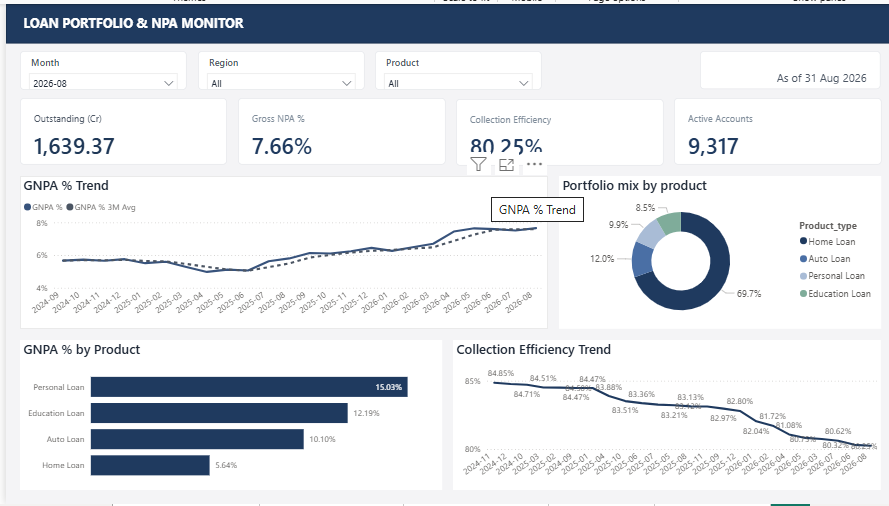
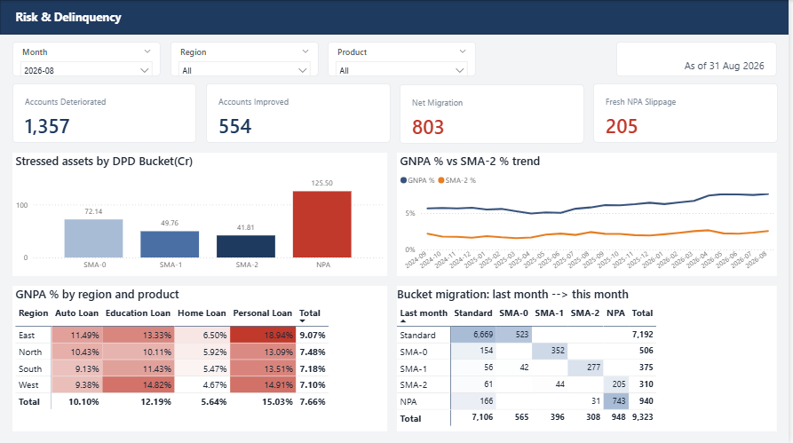
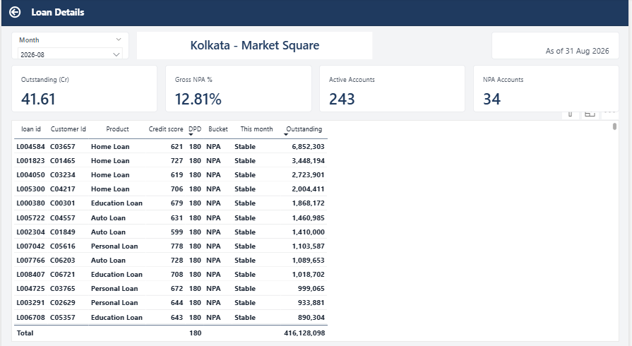
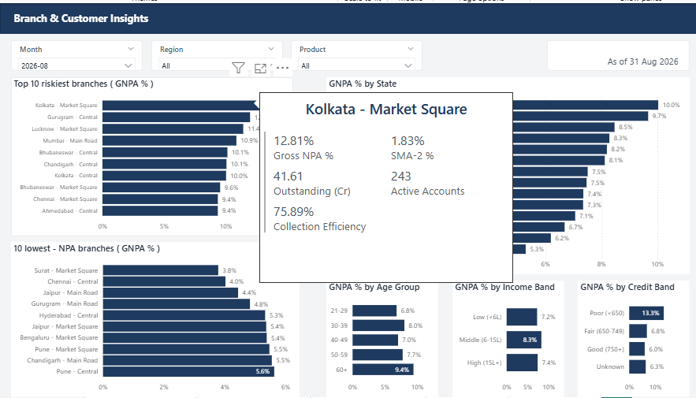
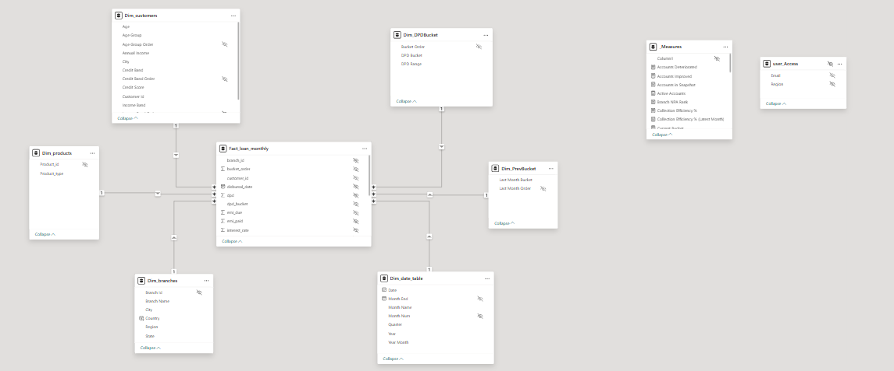

# Loan Portfolio & NPA Monitor

An end-to-end banking analytics project: a synthetic loan book is generated in **Python**, cleaned and validated in **SQL Server**, modelled as a **star schema** in **Power BI**, and presented in a 3-page dashboard with drill-through, tooltips and **row-level security**.

> **Note:** all data is synthetic. It was generated to look like a private bank's loan portfolio. The method is real; the findings describe a made-up bank.

## The business problem

A Credit Risk head needs one monthly answer:

> *How healthy is our loan portfolio, where is it getting worse, and which products, regions, branches and customers are driving that?*

## Skills demonstrated

| Area | What was done |
|---|---|
| Python | Synthetic data generator (pandas, NumPy) with planted risk patterns and deliberate data-quality problems |
| SQL Server | Staging and cleaning, 8 reconciliation checks, views using `CASE`, `LAG()`, `RANK()`, CTEs |
| Data modelling | Star schema, marked date table, role-playing dimension for current vs previous bucket |
| DAX | About 40 measures: snapshot-safe balances, GNPA %, SMA buckets, month-over-month, slippage, ranking |
| Dashboard design | 3 report pages, drill-through to loan level, report-page tooltip, consistent theme |
| Governance | Row-level security by region (static) and by branch manager email (dynamic) |

## Key results (Aug 2026)

| Metric | Value |
|---|---|
| Outstanding | Rs 1,639.37 Cr (9,317 active loans) |
| GNPA % | **7.66%** (5.66% in Sep 2024) |
| Stressed assets (not Standard) | 17.6% of the book (13.4% in Sep 2024) |
| Collection efficiency | 80.25% |
| Accounts that got worse / improved in the month | 1,357 / 554 |
| New NPA slippage in the month | 205 |
| Hotspot | East-region Personal Loans: 18.9% GNPA |
| Strongest customer driver | Credit score below 650: 13.3% GNPA vs 6.0% for 750+ |

## Dashboard


*Page 1: portfolio size, GNPA trend, product mix, collection efficiency.*


*Page 2: stress by DPD bucket, region x product heatmap, bucket migration matrix.*


*Page 3: riskiest and safest branches, state ranking, customer segments.*


*Drill-through: right-click a branch to see its loans, worst first.*


*Hover tooltip with the branch's key numbers.*

## Architecture

```
Python (generate CSVs)
   |
SQL Server: staging -> cleaning -> tables -> reconciliation checks -> views
   |
Power BI (Import mode): Power Query -> star-schema model
   |
DAX measures -> report pages -> drill-through, tooltip -> row-level security
```

## Data model



One fact table (`Fact_loan_monthly`, one row per loan per month) with dimensions for date, branch, product, customer, current DPD bucket and previous DPD bucket. All relationships are many-to-one with single-direction filters.

## Data

| Table | Rows | Description |
|---|---|---|
| customers | 8,000 (8,040 raw) | Age, income, city, credit score, segment |
| branches | 42 | 16 cities, 14 states, 4 regions |
| products | 4 | Home, Personal, Auto, Education loans |
| loans | 9,994 | Amount, rate, tenure, EMI, status |
| repayments | 175,375 | Monthly EMI due/paid, DPD, outstanding balance (Sep 2024 to Aug 2026) |
| date_table | 1,461 | Calendar |

Patterns planted in the data: Personal Loans riskier than Home Loans, East-region Personal Loans as a hotspot, lower credit scores defaulting more, and risk creeping up over time. Age and income have **no** effect, and the dashboard shows that honestly.

## KPI definitions

| Term | Definition |
|---|---|
| DPD | Days past due, in steps of 30 |
| Buckets | Standard (0), SMA-0 (1-30), SMA-1 (31-60), SMA-2 (61-90), NPA (over 90) |
| GNPA % | Outstanding on NPA loans / total outstanding |
| Stressed assets % | Everything not Standard / total outstanding |
| Slippage | Accounts that were not NPA last month but are NPA now |
| Collection efficiency | EMI collected / EMI due |
| Snapshot vs flow | Outstanding balance is a snapshot (read at one date, never summed across months); EMI amounts are flows |

## Row-level security

- **Static roles:** RM East, RM North, RM South, RM West (filter on `Dim_branches[Region]`). The four regions add up to the full portfolio (Rs 1,639.37 Cr).
- **Dynamic role:** `Branch Access` reads `USERPRINCIPALNAME()` and an access table (`dbo.user_access`) so each manager sees only their own branches.

## Repository structure

```
banking-npa-dashboard/
  data/        the 6 generated CSV files
  python/      generate_banking_data.py
  sql/         01_create_and_load.sql, 02_views_and_checks.sql, 03_user_access.sql
  powerbi/     BankingDashboard.pbix, BankingTheme.json
  docs/        Banking_Project_Notes.docx, images/
```

## How to run

1. **Generate the data (optional, the CSVs are included):**
   `pip install -r requirements.txt` then `python python/generate_banking_data.py`
2. **Load into SQL Server:** copy the CSVs to `C:\BankingProject\data\`, then run `sql/01_create_and_load.sql`, `sql/02_views_and_checks.sql` and (optionally) `sql/03_user_access.sql` in SSMS. Edit the folder path in script 01 if yours differs.
3. **Open the report:** open `powerbi/BankingDashboard.pbix` in Power BI Desktop, then **Transform data, Data source settings** and point it to your SQL Server instance (the file was built against `localhost\SQLEXPRESS`, database `BankingDB`).
4. Choose **Month = 2026-08** in the slicer.

## Limitations

- Synthetic data: findings demonstrate the method, not real-bank conclusions.
- No targets or budgets, so there is no "versus goal" view.
- GNPA is balance-weighted; an account-count version is shown separately.
- No provisioning, expected-loss or forecasting layer.

## Possible extensions

Vintage analysis by disbursal month, a GNPA target line, a simple forecast, a credit-score risk model in Python, credit cards as a fifth product, and incremental refresh through a gateway.

## Tools

Python (pandas, NumPy), SQL Server Express and SSMS, Power BI Desktop (Power Query, DAX), Git/GitHub.


[def]: docs/images/03_branch_customer.png